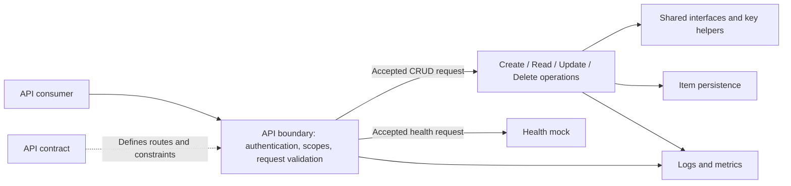
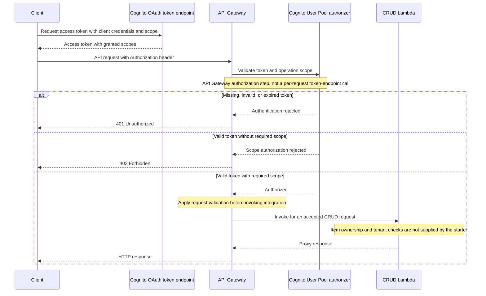
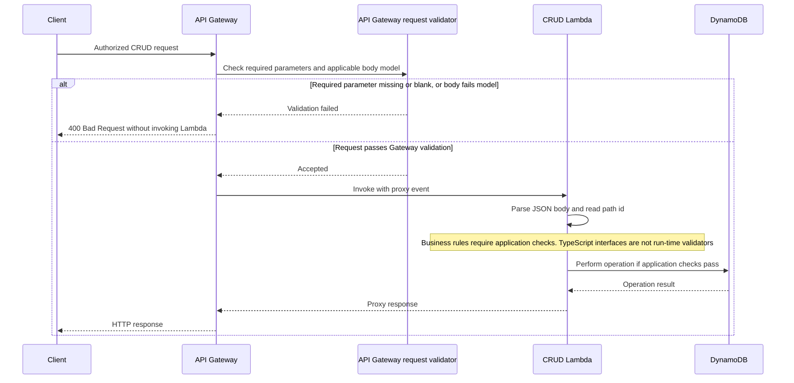
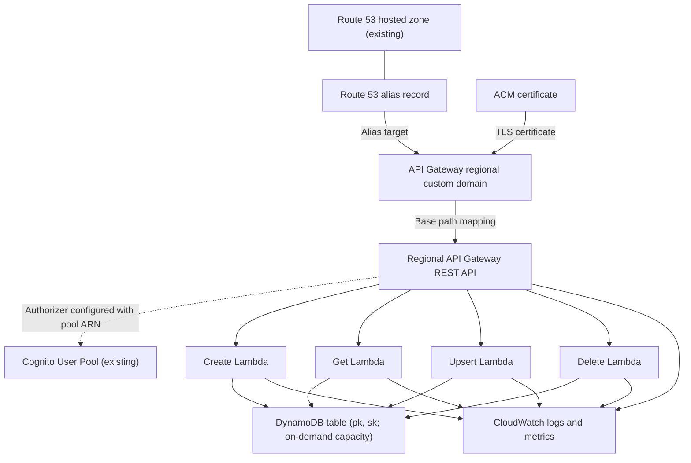
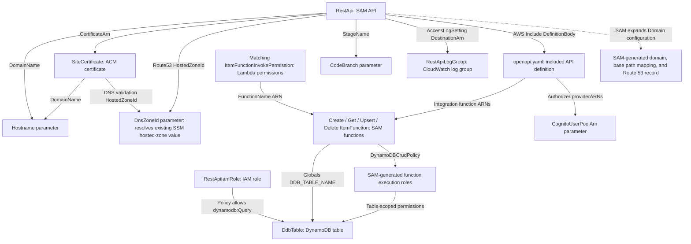

# Architecture

## Infrastructure

### Logical architecture

The service separates the API boundary, business logic, and persistence:

- The API contract defines collection operations, input/output shapes, and
  required authentication scopes.
- Authentication and scope authorization guard the API boundary. Any item-level
  ownership or tenant checks belong in the application logic.
- Each CRUD operation delegates to its own function, using shared interfaces and
  key helpers to keep data handling consistent.
- Persistence stores the collection's items using namespaced composite keys.
- Logs and metrics expose request and function behavior for operations.

The health endpoint checks the API boundary through a mock response; it does
not check business logic or persistence.

#### Logical architecture diagram



#### Authentication and authorization call sequence

This example uses an existing app client with the client-credentials flow
enabled. Interactive clients use their configured OAuth flow instead.
API Gateway validates access tokens using the configured Cognito authorizer;
it does not call the Cognito token endpoint for every API request.



The authorized `/health` route uses a mock integration rather than Lambda.
The pool, OAuth app client, and resource-server scopes must already exist.

#### Request validation call sequence

The `all` validator in `openapi.yaml` enables body and parameter validation.
API Gateway checks required parameters for presence/non-blank values, not
their full declared types or formats. Body validation uses the model matching
the request content type; without a matching model, validation can be skipped.
The diagram assumes an authorized CRUD request with a matching JSON model.



This depicts the validation boundary, not a guarantee that the starter handles
all application validation errors correctly. The only application check in the
starter is Upsert's comparison of the body `id` with the path `id`. The contract
discrepancies listed in [Features](01-features.md) remain subject to separate
review.

### Physical architecture



`template.yaml` owns the DynamoDB table, four Lambda functions and their
API Gateway invoke permissions, API, certificate, and DNS configuration.
The Cognito pool, hosted zone, SSM hosted-zone parameter, and CI roles are
external dependencies.

Each Lambda has a `DynamoDBCrudPolicy` scoped to this table. API routes are
wired through `openapi.yaml`, not through SAM function `Events`. All functions
receive the table name through `DDB_TABLE_NAME`.

The API stage is named by `CodeBranch`. Its access log group is
`/aws/api-gateway/<stack-name>` with seven-day retention. Detailed logging and
metrics are described in [Observability](06-observability.md).

### CloudFormation template

`template.yaml` is the infrastructure-as-code entry point. Its
`Transform: AWS::Serverless-2016-10-31` enables AWS SAM resources, which
CloudFormation expands into the AWS resources needed to deploy the service.

| Section | Purpose |
| --- | --- |
| `Parameters` | Supplies domain/system/component metadata, branch stage name, hostname, hosted-zone SSM parameter, and existing Cognito pool ARN. |
| `Globals.Function` | Sets defaults for the Node.js runtime, timeout, memory, table environment variable, and Powertools service name. |
| `Resources` | Declares the table, functions, invoke permissions, API, certificate, API access log group, and API Gateway IAM role. SAM also generates supporting resources such as function execution roles. |
| Function `Metadata` | Selects `BuildMethod: esbuild` and its `BuildProperties` (entry point, ES module format, `.mjs` output, minification, target) for each function. |

The API's `DefinitionBody` includes `openapi.yaml` through `AWS::Include`.
That file defines routes, Cognito authorization, and Lambda integration ARNs;
the function resources define each handler's code location, build, and
permissions. `Ref` and `GetAtt` connect resources without hard-coding generated
names or ARNs.

#### Template resource relationships

Arrows below run from the referencing resource/configuration to its target;
they show infrastructure references, not request flow. Repeated function and
permission resources are grouped for readability.



Each invoke permission allows the `apigateway.amazonaws.com` principal.
`RestApiIamRole` is declared with a DynamoDB query policy, but the current
OpenAPI integrations do not reference it as integration credentials.
It is not the account-level API Gateway CloudWatch logging role.

`cfn-parameters.json` and `cfn-tags.json` provide deployment-action inputs,
while `samconfig.toml` supplies SAM deployment defaults. See
[Configuration](03-configuration.md) for their expression syntax and external
prerequisites. Validate changes with `sam validate --lint` and bundle function
code with `yarn run sam:build` before deployment.

## Software

### Repository file layout

```text
catalog-info.yaml       Backstage Component and API entities
mkdocs.yml              TechDocs site configuration
docs/handbook/          Handbook pages
README.md               Project entry point
template.yaml           SAM infrastructure
openapi.yaml            API contract and Gateway integrations
cfn-parameters.json     Deployment-action parameter expressions
cfn-tags.json           Deployment-action tag expressions
samconfig.toml          SAM deploy defaults
package.json            Dependencies, Node.js engine, Yarn version, and scripts
.yarnrc.yml             Yarn linker and install settings
tsconfig.json           TypeScript compiler configuration
jest.config.json        Jest configuration
eslint.config.ts        ESLint configuration
.cfnlintrc              CloudFormation lint configuration
.github/workflows/      main.yml and branch.yml
src/lib/                Shared interfaces, key helpers, and their tests
src/handlers/           Per-function handler code and colocated unit tests
```

Local commands also create `node_modules/`, `dist/` (TypeScript output),
`coverage/`, and `.aws-sam/` (SAM build output); all are ignored by Git.
`yarn.lock` is created by your first `yarn install` and should be committed.

These are generated-project paths. The template source repository keeps their
inputs separately under `skeleton/base/`, `skeleton/crud/`, `functions/crud/`,
and `pipeline/` before the scaffolder combines them.

### Node.js and TypeScript

The selected Node.js version is used by Lambda, recorded in `package.json`
`engines`, and used by CI. Source is TypeScript, written as ES modules: relative
imports use `.js` specifiers (for example `../../lib/CreateResponseType.js`)
that resolve to `.ts` files at compile, test, and bundle time. Handlers use the
AWS SDK for JavaScript v3 DynamoDB client, `@aws-sdk/util-dynamodb` for
marshalling, the `aws-lambda` type definitions for API Gateway events, and
Powertools for AWS Lambda (TypeScript) for structured logging.

#### Yarn

##### Dependency management

Yarn 4 manages one `package.json` for the whole repository; there are no
per-function manifests. Enable Corepack so the `packageManager` field selects
the pinned Yarn version, then run `yarn install` from the generated repository
root. The `node-modules` linker installs dependencies into `node_modules/`, and
`yarn.lock` records resolved versions for repeatable installs.

##### Running tasks

Use `yarn run <script>` to execute the scripts defined in `package.json`:

| Script | Runs |
| --- | --- |
| `compile` | `tsc`: type-checks and emits `src/` to `dist/`. |
| `compile:clean` | `clean`, then `compile`. |
| `compile:full` | `tsc` with library checking and without incremental builds. |
| `compile:watch` | `tsc --watch`. |
| `clean` | Removes `dist/` and `.aws-sam/`. |
| `test:unit` | Jest for files matching `.unit.test.ts` under `src/`. |
| `test:all` | Jest for all tests under `src/`. |
| `test` | `compile`, then `test:all`. |
| `lint` | ESLint; see [Common tasks](07-common-tasks.md#validate-and-deploy-changes) for its current state. |
| `sam:build` | `sam build --parallel`. Running it through Yarn puts the project's `esbuild` on `PATH`, which SAM requires. |
| `sam:package`, `sam:deploy` | `sam package` and `sam deploy`. |

`yarn install` manages the development environment, not the deployment
artifact: SAM bundles each function with esbuild from its entry point.

#### Jest for tests

Jest runs TypeScript tests through `ts-jest`, as configured in
`jest.config.json`. Unit tests are colocated with the code they test and named
`*.unit.test.ts`; the `test:unit` script selects them by that suffix. The starter
tests use `aws-sdk-client-mock` to intercept DynamoDB client calls and
`aws-sdk-client-mock-jest` for command assertions such as
`toHaveReceivedCommandWith`.

Jest always collects coverage and prints a report, but no coverage threshold is
configured, so coverage does not fail the build.

Run a focused test with `yarn jest src/handlers/<FunctionName>` from the
generated repository root, then run `yarn run test:unit` for the unit suite.
There are no integration or end-to-end tests, so these tests do not verify the
deployed API or its infrastructure. See [Common tasks](07-common-tasks.md#tests)
for adding and validating tests.

### Anatomy of a function

For example, `src/handlers/Create${{ values.collection_name_cap }}Item/` contains
the following files:

| File | Purpose |
| --- | --- |
| `function.ts` | Defines the exported Lambda entry point `handler` and an exported data-access function (`createItem`) holding the DynamoDB logic, plus logger and client setup. SAM's `Handler: function.handler` selects the bundled module's `handler` export. |
| `function.unit.test.ts` | Unit tests for the handler and data-access function. It sits in the function directory but is not part of the deployed bundle. |

Each function has its own directory and a SAM `CodeUri` pointing to it. SAM's
esbuild builder starts from the `function.ts` entry point, follows its imports
into `src/lib/` and `node_modules/`, and writes a **single minified
`function.mjs` per function**. Only code reachable from that entry point is
included, so test files, other handlers, and dependencies that this handler
does not import stay out of its artifact. No `External` packages are
configured, so each bundle includes the AWS SDK client it uses rather than
relying on the copy in the Lambda runtime.

This keeps each artifact limited to what its function needs, so a large
dependency imported by one function does not increase every other function's
package size and cold-start overhead. Code in `src/lib/` is bundled into each
function that imports it; keep large function-specific dependencies out of
shared modules. Actual cold-start performance also depends on imports, module
initialization, and Lambda configuration.

1. Module initialization creates a Powertools `Logger`, a `DynamoDBClient` for
   the function's region, and reads `DDB_TABLE_NAME` from the environment.
2. `handler(event, context)` receives a typed `APIGatewayProxyEvent` and logs it
   at DEBUG.
3. The handler parses the JSON body into the shared data interface (a type
   assertion, not validation) and/or builds storage keys from the `id` path
   parameter.
4. It delegates to the exported data-access function, which sends one DynamoDB
   command, logs the outcome, and rethrows errors.
5. On success, the handler JSON-encodes a response interface into the body.
   On failure, it maps DynamoDB errors whose `$fault` is `client` to `400` and
   everything else to `500`, with an `{ error, message }` body.
6. It returns an `APIGatewayProxyResult` with `statusCode` and string `body`.
   No response headers are set.

Shared code is in `src/lib/`. `${{ values.collection_name_cap }}Item.ts`
defines `${{ values.collection_name_cap }}Data` (optional `id` plus an index
signature for any other field, which is the place to declare business fields),
`${{ values.collection_name_cap }}ItemKeys` (`pk` and `sk`), and
`${{ values.collection_name_cap }}Item`, which combines keys and data with a
required `id` for storage. `CreateResponseType`, `SuccessResponseType`, and
`ErrorResponseType` define response bodies. Get removes `pk` and `sk` from the
stored item before returning it.

Create uses a conditional `PutItem` to avoid overwriting an existing key.
Upsert uses a conditional `PutItem` requiring an existing key: it replaces the
stored item rather than partially updating attributes. Its `upsert` argument is
currently unused. Delete uses a conditional `DeleteItem` requiring an existing
key.

### Anatomy of a test

`src/handlers/Create${{ values.collection_name_cap }}Item/function.unit.test.ts`
illustrates the starter pattern:

- `mockClient(DynamoDBClient)` intercepts `send` on every `DynamoDBClient`
  instance, including the module-level client in `function.ts`; `beforeEach`
  resets it. The test file's `jest.mock('./function.js', ...)` override of
  `DDB_CLIENT` has no effect because `DDB_CLIENT` is not exported; the
  client mock is what isolates AWS calls.
- `jest.mock('../../lib/<Collection>Item.js', ...)` replaces `createKeys` and
  `getIdFromKeys` with fixed values to make keys and IDs deterministic. The lib
  tests mock `uuid` instead.
- Each test configures DynamoDB responses with `.on(<Command>).resolves(...)`
  or `.rejects(...)`, including `ConditionalCheckFailedException` and
  `DynamoDBServiceException` with client and server faults.
- Handler tests build an `APIGatewayProxyEvent` object inline and a minimal
  `Context` containing `awsRequestId`.
- Data-access tests assert that the expected command was sent and that errors
  propagate; handler tests assert status codes, decoded bodies, and command
  parameters.

Handler logs are written to the test output because the logger is not mocked.
The Get handler's "non-existent item" test simulates a conditional-check failure,
which `GetItem` does not raise; a real missing item returns `500`, as noted in
[Features](01-features.md).

These tests do not exercise deployed API Gateway, Cognito, DNS, or IAM, and
there is no supplied integration or end-to-end suite.
See [Common tasks](07-common-tasks.md) for validation commands.

### Test events and fixtures

The starter has no `data/` directory of JSON examples or JSON Schemas. Tests
construct API Gateway events, request bodies, and DynamoDB items inline, and
`openapi.yaml` is the only schema for request and response shapes. Keep inline
events aligned with the routes and bodies declared there; see
[Common tasks](07-common-tasks.md#test-events-and-fixtures) if you want shared
fixtures.

### DynamoDB single-table design

The table's composite primary key has string **partition key `pk`** and string
**sort key `sk`**. Generic names allow multiple entity types in one table.
The starter uses equal key values for each item:

```text
pk = ${{ values.collection_name_cap }}#<uuid>
sk = ${{ values.collection_name_cap }}#<uuid>
id = <uuid>
```

The namespace is the capitalized collection name, set by `COLLECTION_NAME` in
`src/lib/${{ values.collection_name_cap }}Item.ts`.
`createKeys()` generates these namespaced keys;
`getKeysFromId(id)` reconstructs them for reads, updates, and deletes;
`getIdFromKeys(keys)` extracts the ID by splitting `pk` on `#`.
The API exposes the unprefixed ID, not the storage key, and the stored item also
carries `id` as an attribute.

For more entity types or relationships, design namespaces and access patterns
together, for example `customer#123` and `order#456`. Update all three helpers,
interfaces, and tests consistently; the current extraction logic assumes a simple
`namespace#id` format. Changing key formats requires a migration plan for existing
items. No secondary indexes or relationship-query patterns are supplied.
